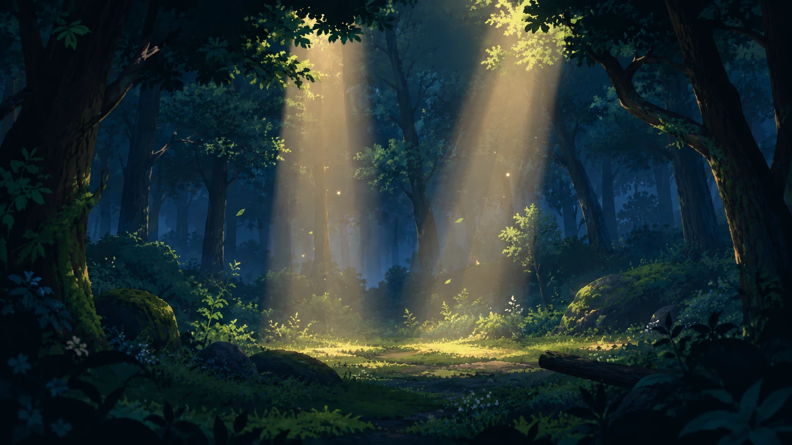

# Hollowbloom

A 2D action platformer built with vanilla JavaScript and the HTML5 Canvas, featuring a custom game loop, levels designed in LDtk and a two-phase final boss.



https://hollowbloom.pages.dev/

## About the game

Fight your way through a mossy forest full of boars, dark elves and skeletons. Every level has a key that opens its portal. In the final arena, **Verdan, Warden of the Grove**, is waiting.

| #   | Level        | Size        | Content                                                                 |
| --- | ------------ | ----------- | ----------------------------------------------------------------------- |
| 1   | `Level_0`    | 4096 × 1024 | 6 enemies, 6 coins, gold key, portal                                    |
| 2   | `Level_1`    | 4096 × 1024 | 6 enemies, 5 coins, checkpoint, healing plant, ancient key, boss portal |
| 3   | `Boss_Level` | 2560 × 1440 | Verdan, 3 coins                                                         |

Coins, time, defeated enemies, deaths and restarts carry over between levels and are shown on the victory screen.

## Features

- Two playable characters. Her special attack freezes enemies, his shocks them. A special attack costs 2 coins.
- Three hearts. Falling into a pit costs one heart and respawns you at the last checkpoint (currently level 2 only).
- Spikes, checkpoints, healing plants, keys and portals.
- Game feel: hit-stop, screen shake, knockback, damage flash, attack buffering (150 ms), a smoothed look-ahead camera, parallax backgrounds, fireflies and dynamic lighting.
- Boss level with camera intro, boss health bar, its own visual theme and adaptive music.
- Settings for volume, fullscreen, language (English and German), screen shake and damage flash, all saved in the browser.
- Touch controls on phones and tablets (landscape only).

## Controls

| Action          | Keyboard             |
| --------------- | -------------------- |
| Move            | `A` `D` or `←` `→`   |
| Run             | hold `Shift`         |
| Jump            | `W`, `Space` or `↑`  |
| Attack          | `J` or `X`           |
| Special attack  | `K` or `C` (2 coins) |
| Pause           | `Esc` or `P`         |
| Restart level   | `R`                  |
| Skip boss intro | jump key             |

Key bindings are defined in `assets/js/data.js`.

## Getting started

The game uses ES modules and loads level data with `fetch`, so it needs a local web server. Opening `index.html` directly won't work.

```bash
git clone https://github.com/YOUR-NAME/hollowbloom.git
cd hollowbloom

npx serve .                  # or
python3 -m http.server 8000  # then open http://localhost:8000
```

The VS Code Live Server extension works as well. There is no build step and nothing to install; `howler.js` is bundled in `assets/js/lib/`.

To start directly in a later level during development, change `START_LEVEL` in `data.js` (for example `3` for the boss arena).

## Project structure

```text
hollowbloom/
├── index.html            canvas, menus, dialogs, touch buttons
├── script.js             init(): wires up all systems
├── style.css
├── ROADMAP1.md           tasks, project parameters, level design rules
└── assets/
    ├── audio/            music/ and sfx/ (each file as .ogg and .m4a)
    ├── css/
    ├── images/
    └── js/
        ├── data.js       central constants: keys, characters, boss, feedback, music
        ├── level/        level-loader.js and one folder per LDtk level
        ├── lib/          howler.js (MIT)
        ├── models/       classes: world, characters, enemies, boss, items, HUD
        └── *.js          input, screens, dialogs, audio, translation, effects
```

## Architecture

**Game loop.** `models/game-loop.class.js` runs a fixed 60 Hz timestep with an accumulator and renders once per `requestAnimationFrame`. It keeps its own game time (`gameLoop.now()`), which stops during pause, the ready phase and the boss intro. It also handles scheduled tasks (`runEvery`, `runAfter`) and hit-stop.

**World.** The world is split into three layers:

- `WorldLogic`: game rules per tick (hazards, checkpoints, pickups, collisions, boss effects, timer, game over, victory)
- `WorldRendering`: camera, shake, damage flash, draw order
- `World`: entering and preloading levels, music, carrying stats between levels

**Class hierarchy.**

```text
DrawableObject
├── MoveableObject
│   ├── CharacterBase → CharacterMovement → CharacterCombat → CharacterVisuals → MaleCharacter → FemaleCharacter
│   ├── EnemyBehavior → Enemy → ConfigurableEnemy → Boar | DarkElf | Skeleton
│   └── VerdanBase → VerdanAttacks → VerdanHealth → VerdanBoss
└── BossEffect, ChargeItem (coin), KeyItem, ExitPortal, Checkpoint, HealingPlant, StatusBar
```

**Collision.** Ground collision uses a 32 px tile grid from `Collisions.csv`: `0` empty, `1` solid, `2` hazard, `3` one-way platform. Hits between characters, enemies and effects use rectangular hitboxes that flip with facing direction.

## Levels with LDtk

Levels are built in [LDtk](https://ldtk.io) at a 1:1 scale on a 32 px grid and exported with the "Super simple export". Each level folder in `assets/js/level/` contains `data.json`, `Collisions.csv` and the painted layers as WebP.

| Entity               | Effect                                                                    |
| -------------------- | ------------------------------------------------------------------------- |
| `Player`             | start position (one per level)                                            |
| `Coin`               | coin for the special attack                                               |
| `Enemy_Patrol`       | enemy; fields `type` (`Boar`, `DarkElf`, `Skeleton`) and `range` in cells |
| `Key` / `Boss_Key`   | opens `Exit` / `Exit_Boss`                                                |
| `Exit` / `Exit_Boss` | portal to the next level / to the boss arena                              |
| `Checkpoint`         | new respawn point                                                         |
| `Healing_Plant`      | restores all hearts when the character is injured                         |
| `Boss`               | Verdan; turns the level into a boss level automatically                   |

**Adding a level:** build and export it in LDtk, put the folder in `assets/js/level/`, and add the folder name to `LEVEL_FOLDERS` in `data.js`. The next level is preloaded shortly after entering the current one.

## Enemies and boss

| Enemy    | HP  | Behaviour                                                      |
| -------- | --- | -------------------------------------------------------------- |
| Boar     | 3   | charge attack, defensive stance afterwards                     |
| Dark elf | 2   | fast, two weighted attacks                                     |
| Skeleton | 4   | attack armour: hits deal damage but don't interrupt its attack |

**Verdan** has 12 HP and enters a rage phase at half health. He picks attacks by distance: seed-arrow volleys, a row of root spikes and, in rage only, a pulse burst. After each hit he is protected for 700 ms and counters quickly, so button mashing doesn't work. All timings and hitboxes are in `VERDAN_SETTINGS` in `data.js`.

## Configuration

| Constant (`data.js`)                               | Purpose                                    |
| -------------------------------------------------- | ------------------------------------------ |
| `LEVEL_FOLDERS`, `START_LEVEL`                     | level order and start level                |
| `ENTITY_SCALE`                                     | scale of characters and physics            |
| `EXTRA_ATTACK_COIN_COST`                           | coin cost of the special attack            |
| `MALE_CHARACTER_CONFIG`, `FEMALE_CHARACTER_CONFIG` | sprites, hitboxes, speed, reach            |
| `VERDAN_SETTINGS`                                  | boss animations, attacks and effects       |
| `HIT_FEEDBACK`                                     | shake, hit-stop and knockback per hit type |

## Audio, settings and translation

- Music uses `HTMLAudioElement` with fades; sound effects use howler.js with random variants and slight pitch variation. Safari and iOS get `.m4a` files, all other browsers `.ogg`.
- Settings are stored in `localStorage` under `audio-settings`, `language`, `screen-shake` and `damage-flash`. Screen shake and damage flash default to off when `prefers-reduced-motion` is set.
- All texts live in `translation.js`. HTML elements reference them with `data-i18n` or `data-i18n-aria-label`. The default language is English.

## Credits

| Area           | Asset                                                                                                                                                                                                     | Author                          |
| -------------- | --------------------------------------------------------------------------------------------------------------------------------------------------------------------------------------------------------- | ------------------------------- |
| Characters     | [Free Fantasy Chibi Male Sprites](https://craftpix.net/freebies/free-fantasy-chibi-male-sprites-pixel-art/), [Female Sprites](https://craftpix.net/freebies/free-fantasy-chibi-female-sprites-pixel-art/) | CraftPix.net                    |
| Enemies        | [Wild Boar](https://hsdsz.itch.io/wild-boar-2d-animated-beast-enemy-pack), [Dark Elf Rogue](https://hsdsz.itch.io/dark-elf-rogue-fantasy-rpg-001-2d-animated-character-pack)                              | hsdsz                           |
| Enemies        | [Skeleton Axe](https://spritekitchen.itch.io/skeleton-axe-animated-enemy-sprite-pack)                                                                                                                     | spritekitchen                   |
| Level graphics | [Mossy Cavern](https://maaot.itch.io/mossy-cavern)                                                                                                                                                        | Maaot                           |
| Status bar     | [Hearts and health bar](https://fliflifly.itch.io/hearts-and-health-bar) (CC0)                                                                                                                            | VampireGirl                     |
| Icons          | [Loot Essentials](https://spritekitchen.itch.io/loot-essentials-free-pixel-art-item-pack)                                                                                                                 | spritekitchen                   |
| Music          | [Hyper Ultra-Racing](https://opengameart.org/content/hyper-ultra-racing)                                                                                                                                  | The Cynic Project               |
| Sounds         | [Magic Spell SFX Soundpack](https://thesoundrack.itch.io/freemagicspellsfx)                                                                                                                               | Leonardo Calvo                  |
| Library        | [howler.js](https://howlerjs.com) v2.2.4, MIT                                                                                                                                                             | James Simpson, GoldFire Studios |

Some graphics and sounds were created with AI. All assets belong to their respective authors and are subject to their licenses.

---

A private, non-commercial hobby and learning project.
